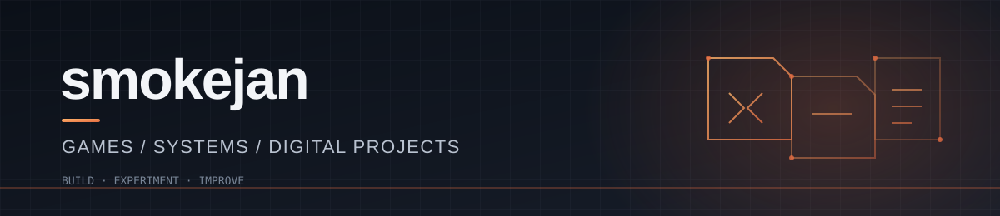

<div align="center">



### Building experiences across media, entertainment and technology.

From television lighting and live entertainment to digital content, launch operations, game systems and independent projects.

[](https://github.com/smokejan)
[](https://wildmu.com)

</div>

---

## About

I'm a creative and hands-on professional with a background that brings together **audiovisual production, entertainment, digital communication, games and technology**.

I spent 10 years working at **TV Globo as a Light Designer**, contributing to productions across drama, shows and entertainment. That experience shaped the way I think about visual composition, atmosphere, timing and audience experience.

Today, I work at **Inside The Show**, combining content production, audiovisual work, launch and event operations, and communication automation. Alongside that, I develop independent projects involving games, multiplayer environments, software tools and digital products.

I enjoy moving between creative and operational work: understanding what needs to happen, organizing the process and making the experience work for the people involved.

## Professional experience

### Inside The Show
**Content · Audiovisual · Launch & Event Operations**

My work involves different parts of the content and campaign operation:

- **Content & social media** — creating and preparing content for social channels, including Instagram.
- **Audiovisual production** — capturing and preparing video content.
- **Launch campaigns** — supporting campaign planning, meetings and execution.
- **Event operations** — organizing communication and participant flows for live events.
- **Community management** — helping operate large WhatsApp community structures and message distribution.
- **Communication automation** — working with ManyChat flows, live-session invitations and tracked links using Short.io and UTM parameters.

### Light Designer · TV Globo
**10 years**

Worked across different areas of television entertainment, including:

- **Drama** — lighting for narrative and fictional productions.
- **Shows** — visual lighting for show productions.
- **Entertainment** — lighting design for entertainment programming.

## Focus areas

| Area | What I work on |
|---|---|
| **Audiovisual & content** | Video capture, content production and social media |
| **Launch & event operations** | Campaign support, event communication and participant flows |
| **Automation & communities** | ManyChat, WhatsApp operations, tracked links and communication workflows |
| **Game systems** | Gameplay features, custom tools and experiments with game technology |
| **Multiplayer & servers** | Server-side logic, progression, events and player experience |
| **Visual experience** | Composition, atmosphere, lighting and presentation |
| **Tools & products** | Interfaces, automation and ideas shaped into usable digital products |

## Selected work

### [offline-base-protection](https://github.com/smokejan/offline-base-protection)
**Project Zomboid · Lua · Build 42**

A multiplayer mod focused on protecting unattended bases while the server remains online. It addresses fuel consumption and food spoilage when players are away, without pausing the world for everyone else.

### [WildMU](https://wildmu.com)
**MU Online · C++ · Lua · Multiplayer systems**

An ongoing private-server project built around custom systems and the player experience — including progression, PvP, automated events, bosses, community features and client-side improvements.

### Game tools & experiments

I also work on custom interfaces, overlays and tools connected to game projects, exploring how existing experiences can be extended or made more practical.

## Technology & tools

I use different tools depending on the problem and the project.

```text
Development     C++ · Lua · TypeScript · Node.js
Game tech       Unreal Engine
Data            PostgreSQL · SQLite
Infrastructure  Linux
Automation      ManyChat · Short.io · UTM workflows
```

## How I approach projects

- **Think about the whole experience.** Good work combines what happens behind the scenes with what people see and use.
- **Connect creative and technical thinking.** Visual storytelling, communication and systems can strengthen one another.
- **Build to understand.** I prefer testing an idea in practice instead of leaving it on paper.
- **Keep it practical.** Clear solutions are better than complexity without a purpose.
- **Improve continuously.** I treat feedback, testing and iteration as part of the process.

---

<div align="center">

**From lighting the scene to building the experience.**

<sub>Audiovisual · Entertainment · Digital operations · Games · Technology</sub>

</div>
